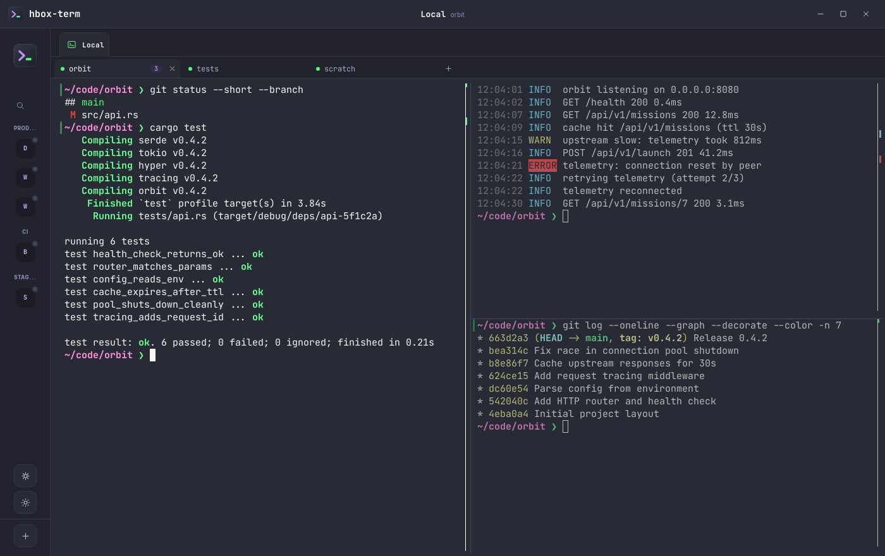

# hbox-term

[](https://github.com/MohamedElashri/hbox-term/releases)
[](LICENSE)

A desktop terminal for local and remote development on Linux and macOS, built with Rust and
Tauri 2. It opens straight into your local shell and keeps your servers next to it: SSH terminals,
files, services, containers and logs, with nothing installed on the remote side.

<p align="center">
  
</p>


The [user guide](USER_GUIDE.md) covers everything in detail, and the [changelog](CHANGELOG.md)
lists what each release adds.

## Install

**Linux and macOS:**

```sh
curl -fsSL https://raw.githubusercontent.com/MohamedElashri/hbox-term/main/install.sh | sh
```

The script picks the right package (`.deb`, `.rpm` or AppImage on Linux, the `.dmg` for your Mac's
architecture), verifies it against `SHA256SUMS.txt` and installs it. Set `HBOX_TERM_VERSION=v0.1.0`
to pin a release.

**Manual download:** get the package for your platform from the
[releases page](https://github.com/MohamedElashri/hbox-term/releases).

| Platform | Package |
|---|---|
| macOS Apple Silicon / Intel | `.dmg` for your architecture |
| Linux x86_64 / ARM64 | `.deb`, `.rpm` or `.AppImage` |

> [!NOTE]
> **macOS:** the app is not notarized, so macOS blocks a downloaded copy ("hbox-term is damaged"
> or "cannot be opened"). After moving it to Applications, allow it with
> `xattr -dr com.apple.quarantine /Applications/hbox-term.app`. The install script does this for you.

## Development

Requires Node.js, Rust and the [Tauri prerequisites](https://v2.tauri.app/start/prerequisites/).

```sh
make dev      # run the app with hot reload
make test     # frontend and backend tests
make build    # release packages for this OS
make help     # list every target
```

See the [developer guide](DEVELOPER_GUIDE.md) for dependencies, architecture and releasing.

## License

[MIT](LICENSE). Bundles JetBrains Mono under the
[SIL Open Font License](licenses/JetBrainsMono-OFL.txt).
