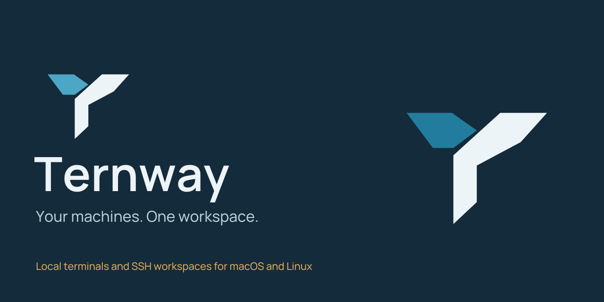

# Ternway

**Your machines. One workspace.**

<p align="center">
  
</p>

[](https://github.com/MohamedElashri/ternway/releases)
[](LICENSE)

A desktop terminal for local and remote development on Linux and macOS, built with Rust and
Tauri 2. It opens straight into your local shell and keeps your servers next to it: SSH terminals,
files, services, containers and logs, with nothing installed on the remote side.

The [user guide](USER_GUIDE.md) covers everything in detail, and the [changelog](CHANGELOG.md)
lists what each release adds.

## Install

**Linux and macOS:**

```sh
curl -fsSL https://raw.githubusercontent.com/MohamedElashri/ternway/main/install.sh | sh
```

The script picks the right package (`.deb`, `.rpm` or AppImage on Linux, the `.dmg` for your Mac's
architecture), verifies it against `SHA256SUMS.txt` and installs it. Set `TERNWAY_VERSION=v0.2.1`
to pin a release.

**Manual download:** get the package for your platform from the
[releases page](https://github.com/MohamedElashri/ternway/releases).

| Platform | Package |
|---|---|
| macOS Apple Silicon / Intel | `.dmg` for your architecture |
| Linux x86_64 / ARM64 | `.deb`, `.rpm` or `.AppImage` |

> [!NOTE]
> **macOS:** the app is not notarized, so macOS blocks a downloaded copy ("Ternway is damaged"
> or "cannot be opened"). After moving it to Applications, allow it with
> `xattr -dr com.apple.quarantine /Applications/Ternway.app`. The install script does this for you.

## Development

Requires Node.js, Rust and the [Tauri prerequisites](https://v2.tauri.app/start/prerequisites/).

```sh
make dev      # run the app with hot reload
make test     # frontend and backend tests
make build    # release packages for this OS
make help     # list every target
```

See the [developer guide](DEVELOPER_GUIDE.md) for dependencies, architecture and releasing.

## License

[MIT](LICENSE). Bundles JetBrains Mono under the
[SIL Open Font License](licenses/JetBrainsMono-OFL.txt).

## Updates

Use **Ternway → Check for updates…** on macOS, **Help → Check for updates…** on Linux,
or the button in **About Ternway**. Settings → Updates and the command palette offer the
same flow: check GitHub releases, read the release notes, download and install a signed update,
then restart when you’re ready. Restarting ends active terminal sessions. Source and development
builds link to release downloads instead of replacing themselves.

## About Ternway

Open **Settings → About → About Ternway** for version/build details, project links, credits
and license information. On macOS, **Ternway → About Ternway** opens the same page.

### OpenSSH configuration

Import aliases as **OpenSSH config** connections to keep routing, authentication and advanced
rules linked to the source file. They open in Ternway's terminal using the system SSH client.
Managed connections continue to provide graphical file and server tools.
[Compatibility details](docs/OPENSSH.md).
